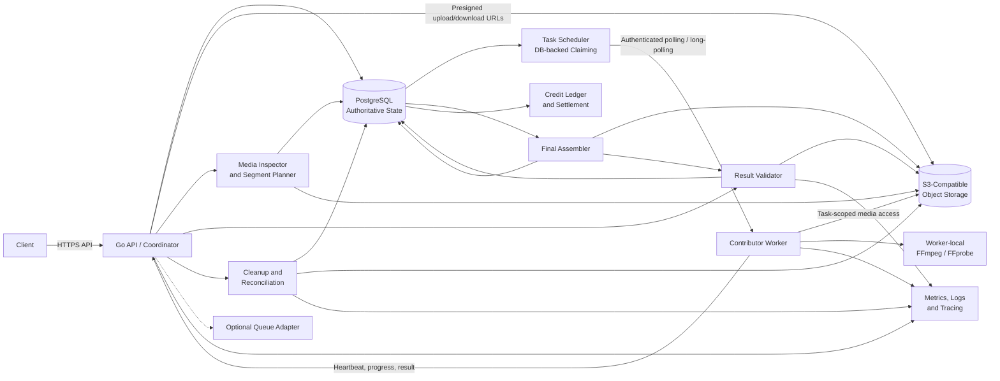
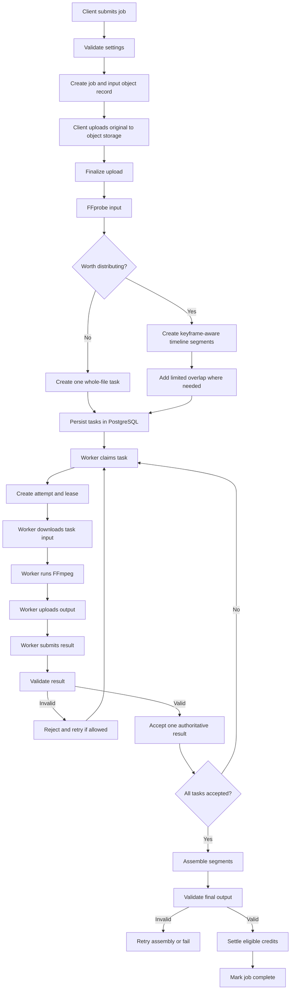
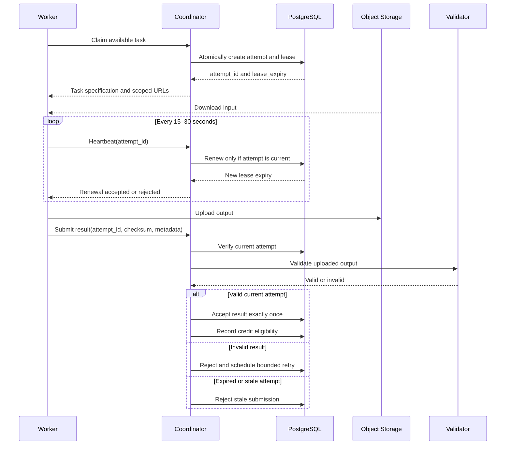
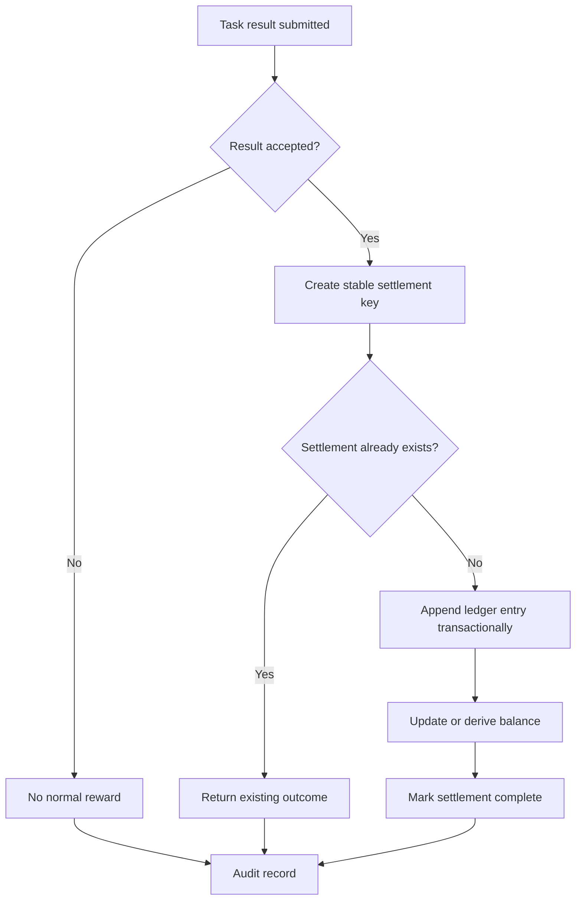
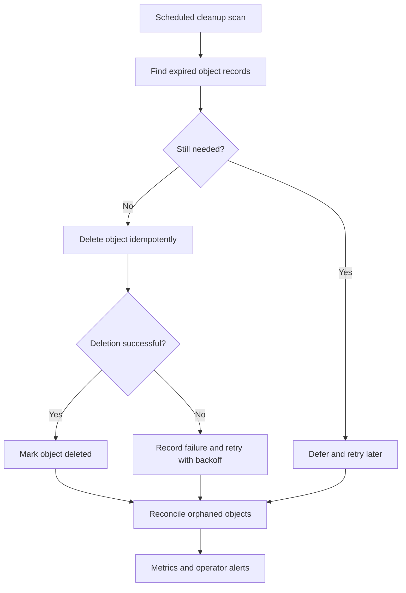

# Bergen Distributed Video Compressor — Design Reference

This document captures the recommended architecture, workflows, invariants, and component tradeoffs for Bergen. The attached image was used only as a readability reference.

## 1. High-level architecture

PostgreSQL decides what is true: task ownership, current attempts, accepted results, job completion, and credit settlement. Object storage holds large data; workers process it; an optional queue only improves dispatch.

## 2. Job-processing workflow

## 3. Lease and stale-attempt flow

Provisional defaults: heartbeat every 15–30 seconds; lease around twice the estimated task duration plus network grace; about three attempts; late results rejected if a newer attempt owns or completed the task.

## 4. Credit settlement

Use a uniqueness rule such as `(task_id, accepted_result_id, reward_type)`. Repeated requests cannot create another reward.

## 5. Cleanup and retention

## Recommended MVP defaults

- MP4 container, H.264 video, AAC audio.
- Initially one video stream and one audio stream.
- Server-defined encoding parameters; no arbitrary worker FFmpeg commands.
- Worker enrollment token followed by persistent worker credentials.
- Outbound authenticated polling or long-polling.
- Short-lived, task-scoped object-storage permissions.
- Keyframe-aware segments with limited overlap where needed.
- Single-worker fallback for short or unsuitable videos.
- PostgreSQL-backed task claiming first; queue adapter later if measurements justify it.
- Attempt IDs required for heartbeats and result submission.
- At-most-once accepted result per task.
- At-most-once normal credit settlement per accepted task.
- Bounded retries and idempotent cleanup.

## Component analysis

### Client

Responsibility: submit jobs, upload videos, monitor status, download results, and view credits. It should use direct object-storage uploads for large files. It must support idempotency and resumable uploads. Its drawback is handling interruptions and delayed asynchronous work. It is recommended as a thin client because it keeps media transfer out of API handlers. Arbitrary FFmpeg command construction is out of scope.

### Go API/coordinator

Responsibility: authenticate requests, authorize operations, and coordinate state transitions. It exposes client and worker APIs and manages idempotency, leases, and policy. Its advantage is centralized correctness; its drawback is potential growth into a large service. It must never relay all video bytes. A single Go coordinator is recommended for the MVP; service splitting can wait for measured pressure.

### PostgreSQL

Responsibility: authoritative durable state for users, workers, jobs, tasks, attempts, leases, results, credits, and cleanup records. Transactions, uniqueness constraints, row locks, and compare-and-set updates enforce correctness. Its drawback is that very high-volume dispatch may eventually need support. It is recommended as the initial source of truth. Video bytes do not belong in database rows.

### Object storage

Responsibility: store originals, segments, worker outputs, assembled results, and final downloads. It provides scale and direct transfer, but introduces egress, orphan, multipart, and cleanup costs. Use short-lived object-specific permissions and never give workers broad credentials. S3-compatible storage is recommended; lifecycle rules can supplement application reconciliation later.

### Media inspector

Responsibility: use FFprobe to inspect containers, streams, codecs, duration, frame rate, and timestamps. It provides cheap early rejection, but metadata cannot prove honest computation. Run it with timeouts and isolation because media is hostile input. FFprobe behind a controlled interface is recommended.

### Segment planner

Responsibility: decide whether distribution is worthwhile and produce safe timeline boundaries. It should use keyframe-aware boundaries, limited overlap, and a whole-file fallback. Its main drawback is boundary complexity: gaps, duplication, and audio drift are possible. This hybrid strategy is recommended because distribution is not beneficial for every video. Arbitrary editing timelines are out of scope.

### Task scheduler

Responsibility: make eligible work claimable by compatible workers while enforcing concurrency, fairness, retries, and capability matching. Its drawback is inaccurate estimates and slow-worker tail latency. PostgreSQL-backed claiming is recommended first; Redis/Asynq can later improve dispatch without becoming authoritative.

### Contributor worker

Responsibility: authenticate, claim, process, upload, heartbeat, and report tasks. Outbound polling works behind NAT and tolerates intermittent connectivity. Workers are untrusted and may crash, lie, or be slow. Use persistent worker credentials, scoped URLs, local resource limits, and graceful shutdown. Workers must not access PostgreSQL, Redis, or broad cloud credentials.

### FFmpeg and FFprobe execution

Responsibility: perform encoding and inspection. FFmpeg is mature and practical but complex and security-sensitive. Construct arguments from server-defined typed settings, isolate processes, enforce CPU/memory/disk/time limits, and kill hangs. Custom codecs and arbitrary shell commands are out of scope.

### Result validator

Responsibility: check object existence, checksum, parsing, streams, duration, codec, settings, timestamps, and decoding. Layered validation keeps cheap checks early and deeper checks selective. It cannot detect every colluding or dishonest worker, but it greatly reduces obvious fraud and corruption. Rejected results receive no normal reward.

### Final assembler

Responsibility: combine accepted segments and verify order, timestamps, streams, duration, synchronization, and decoding. It introduces a serial phase and possible bottleneck, but centralizes final correctness. Only accepted, authorized objects may be assembled. A job cannot succeed before final validation.

### Credit ledger and settlement

Responsibility: record rewards, spending, reversals, and adjustments. Immutable ledger entries preserve audit history. Stable settlement keys and database uniqueness prevent duplicate awards. Workers cannot choose reward amounts, and failed work receives no normal reward. Cryptocurrency and real-money payments are out of scope.

### Cleanup and reconciliation

Responsibility: delete expired objects, retry failed deletions, remove abandoned multipart uploads, and reconcile storage/database drift. It must not delete objects still needed by active tasks, validation, retry, or assembly. URL expiry is not deletion. Scheduled cleanup plus explicit object lifecycle records is recommended.

### Observability

Responsibility: expose job latency, queue delay, retries, lease expiry, invalid results, credit settlements, storage usage, transfer volume, cleanup lag, and orphan counts. Structured logs should include correlation IDs but never media contents, credentials, or presigned URLs. This is essential for diagnosing stuck jobs and repeated failures.

## Explicitly unresolved decisions

- Maximum file size and duration.
- Exact lease multiplier and retry count after benchmarking.
- Final-output retention duration and extension policy.
- Redundant-validation percentage.
- Supported worker operating systems.
- Hardware acceleration.
- Exact credit formula.
- Public internet launch timing.
- Whether users may process their own jobs for credits.

These should be configuration or policy decisions, not hidden assumptions in the core correctness model.

