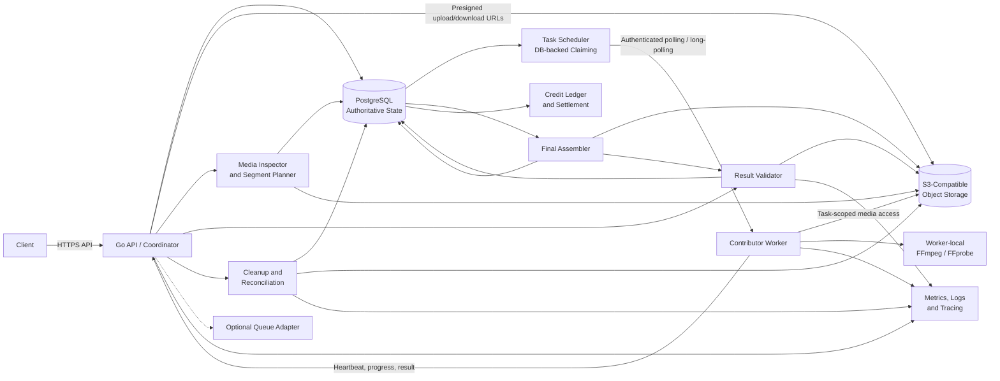

# Architecture

This document describes the logical architecture for a crowdsourced distributed video compressor.

## High-level architecture

PostgreSQL is the source of truth for task ownership, current attempts, accepted results, job completion, and credit settlement. Object storage holds large data, while workers process it. An optional queue can improve dispatch without changing these ownership rules.

## Component responsibilities

### Client

The client submits jobs, uploads videos, monitors status, downloads results, and displays credits. Large files go directly to object storage. Idempotency keys and resumable uploads handle retries and interrupted transfers. Arbitrary FFmpeg command construction is outside this boundary.

### Go API and coordinator

The API authenticates requests, authorizes operations, and coordinates state transitions. It exposes client and worker APIs and manages idempotency, leases, and policy. Large video transfers bypass the API and use object storage directly. A single Go coordinator is sufficient for the initial deployment; service separation remains a later scaling option.

### PostgreSQL

PostgreSQL stores users, workers, jobs, tasks, attempts, leases, results, credits, and cleanup records. Transactions, uniqueness constraints, row locks, and compare-and-set updates protect state transitions. Video bytes remain in object storage rather than database rows.

### Object storage

Object storage holds originals, segments, worker outputs, assembled results, and final downloads. It provides scale and direct transfer, with egress, orphan, multipart, and cleanup costs as tradeoffs. Workers receive short-lived, object-specific permissions rather than broad storage credentials.

### Media inspector

FFprobe inspects containers, streams, codecs, duration, frame rate, and timestamps. This provides inexpensive early rejection, although metadata alone cannot prove that a worker performed the requested computation. Timeouts and process isolation limit exposure to malformed media.

### Segment planner

The planner decides whether distribution is worthwhile and produces timeline boundaries. Keyframe-aware boundaries, limited overlap, and a whole-file fallback address frame dependencies and scheduling overhead. Arbitrary editing timelines are outside this model.

### Task scheduler

The scheduler makes eligible work claimable by compatible workers while applying concurrency, fairness, retries, and capability matching. PostgreSQL-backed claiming provides the initial implementation. Redis/Asynq remains a possible dispatch optimization without becoming authoritative.

### Contributor worker

The worker authenticates, claims, processes, uploads, heartbeats, and reports tasks. Outbound polling works behind NAT and tolerates intermittent connectivity. Workers are untrusted and may crash, lie, or be slow. Database, queue, and broad cloud credentials stay on the service side.

### FFmpeg and FFprobe execution

FFmpeg and FFprobe perform encoding and inspection. Typed server-defined settings become process arguments. Process isolation, CPU/memory/disk/time limits, and hang termination contain failures. Custom codecs and arbitrary shell commands are outside the initial interface.

### Result validator

The validator checks object existence, checksum, parsing, streams, duration, codec, settings, timestamps, and decoding. Cheap checks run first, with deeper checks applied selectively. This catches corruption, mismatched outputs, and many fabricated results, but it does not prove that every dishonest or colluding worker was detected.

### Final assembler

The assembler combines accepted segments and verifies order, timestamps, streams, duration, synchronization, and decoding. Assembly reads only accepted, authorized objects. Job completion follows final validation.

### Credit ledger and settlement

The ledger records rewards, spending, reversals, and adjustments. Immutable entries preserve the audit history. Stable settlement keys and database uniqueness prevent duplicate awards. Cryptocurrency and real-money payments are outside the initial accounting model.

### Cleanup and reconciliation

Cleanup deletes expired objects, retries failed deletions, removes abandoned multipart uploads, and reconciles storage/database drift. Reference checks protect objects still needed by active tasks, validation, retry, or assembly.

### Observability

Observability covers job latency, queue delay, retries, lease expiry, invalid results, credit settlements, storage usage, transfer volume, cleanup lag, and orphan counts. Structured logs carry correlation IDs while excluding media contents, credentials, and presigned URLs.
