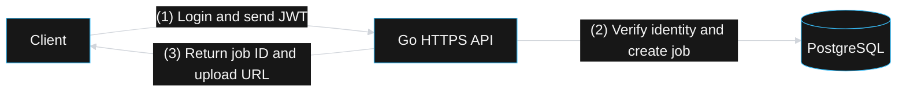
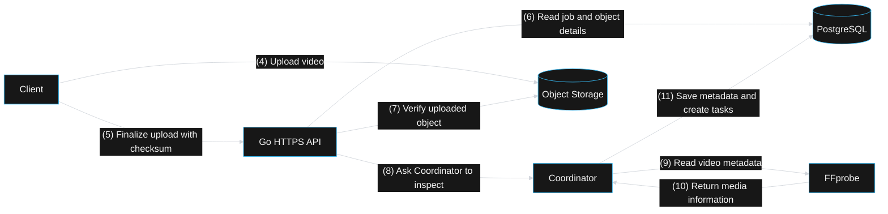
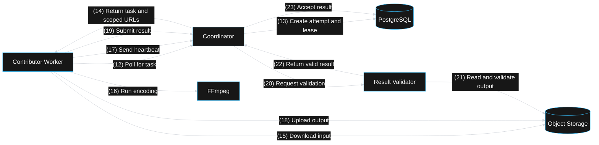
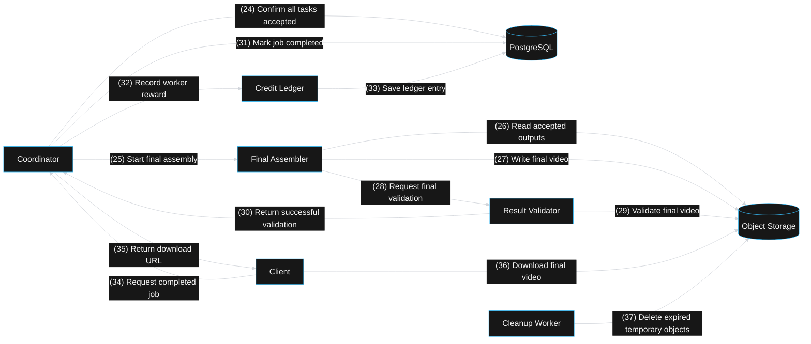

# Happy Path

These diagrams describe the successful path from authentication through cleanup. Each section isolates one stage so the rendered graph stays readable.

## (1)–(3): Authentication and job creation

## (4)–(11): Upload and media inspection

## (12)–(23): Worker processing and validation

## (24)–(37): Assembly, credits, download, and cleanup

