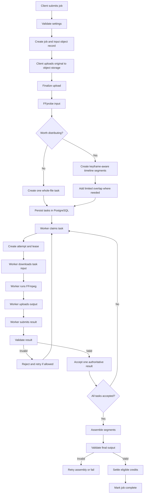
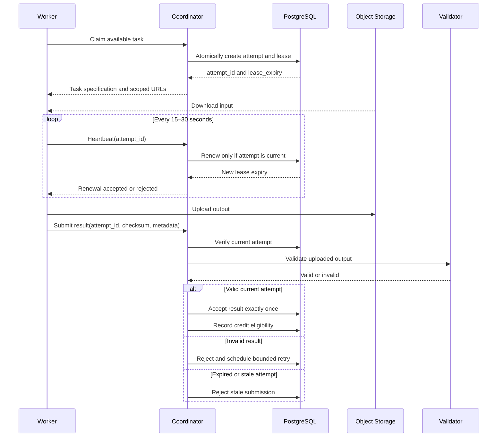
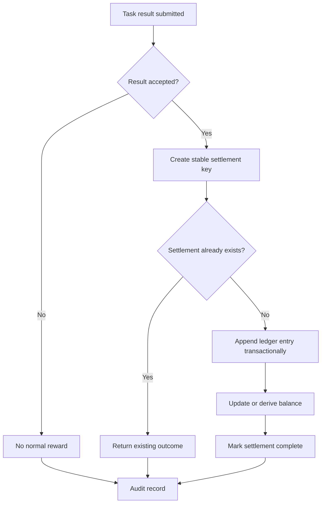
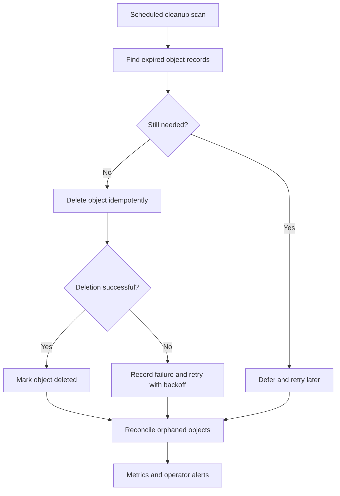

# Workflows

## Job-processing workflow

## Lease and stale-attempt flow

Initial timing values are heartbeat intervals of 15–30 seconds, a lease near twice the estimated task duration plus network grace, and about three attempts. A result from an attempt replaced by a newer owner is stale and is rejected.

## Credit settlement

The settlement key can use `(task_id, accepted_result_id, reward_type)`. Repeated requests resolve to the existing ledger outcome rather than creating another reward.

## Cleanup and retention

URL expiration and object deletion are separate operations. A presigned URL expiring does not delete an object.
